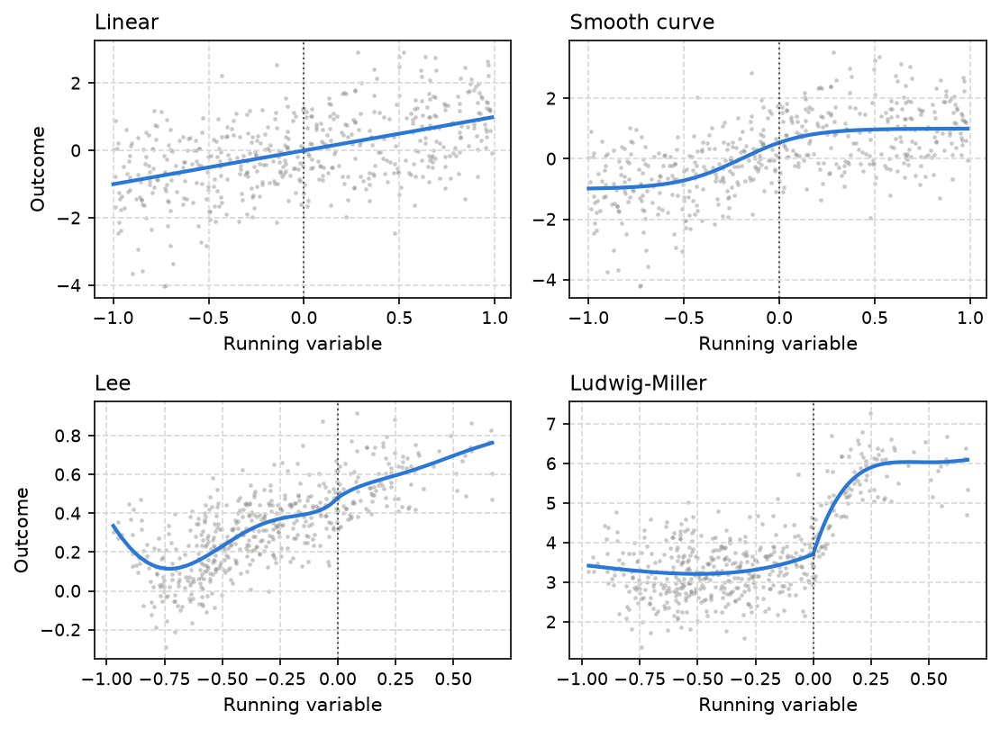
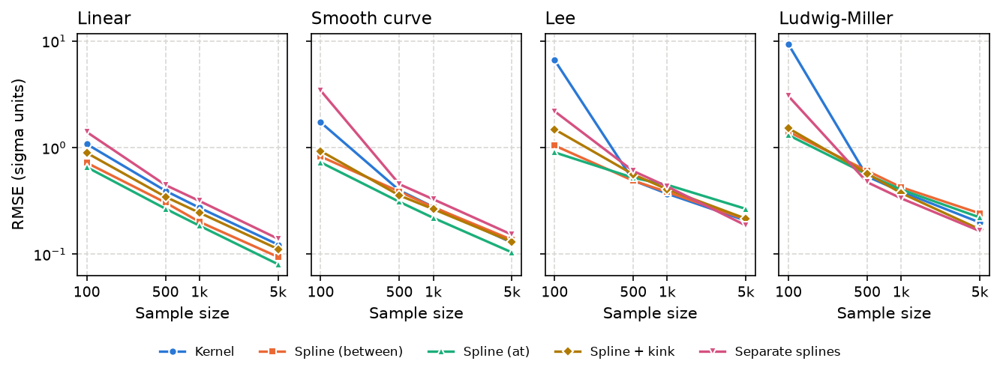
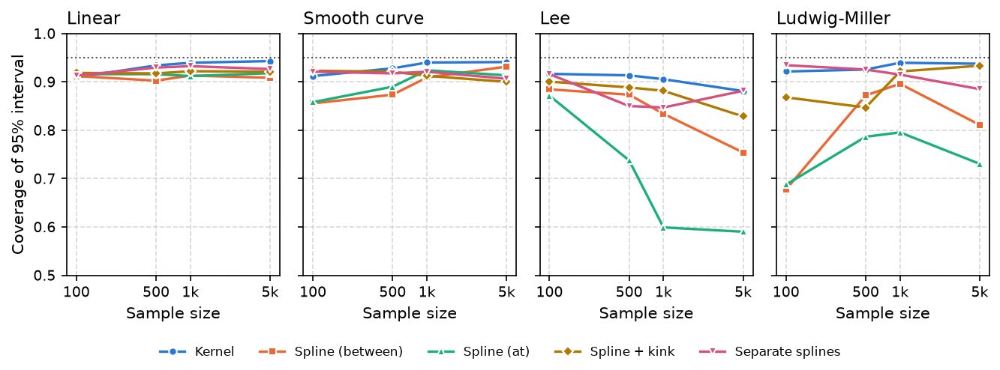
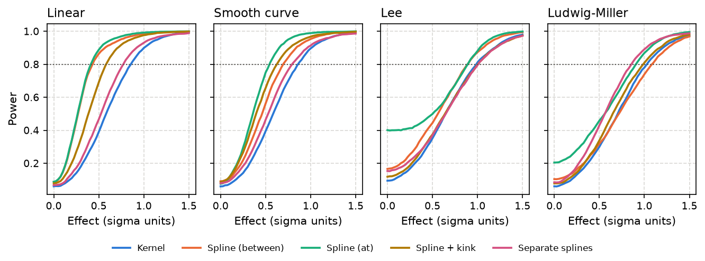
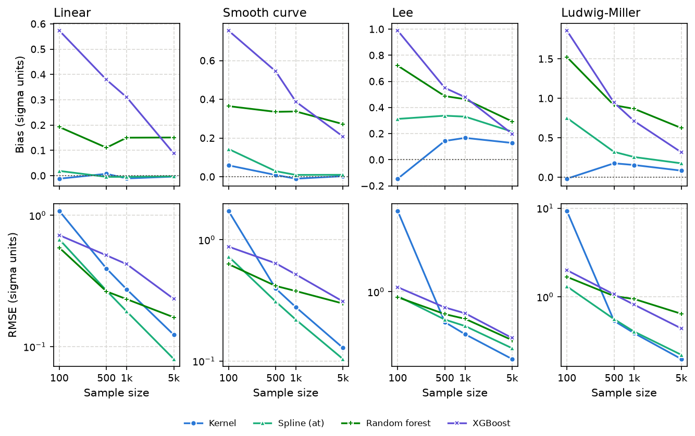
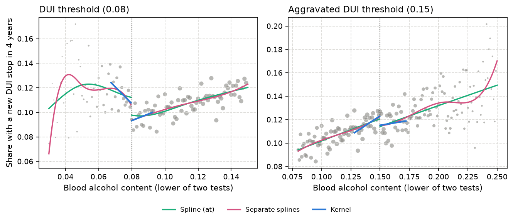

# Just use regression (most of the time) for RDD
Andrew P. Wheeler

# Introduction

Regression discontinuity designs (RDD) estimate the effect of a treatment that is assigned by a cutoff on a continuous score. Cases just above and just below the cutoff should be similar, so a jump in the outcome at the cutoff estimates the effect of the treatment ([Thistlethwaite and Campbell 1960](#ref-thistlethwaite1960regression); [Hahn, Todd, and Van der Klaauw 2001](#ref-hahn2001identification)). Criminology has used the design since the early 1980s, to evaluate unemployment benefits for people released from prison ([Berk and Rauma 1983](#ref-berk1983capitalizing)), prison security classification scores ([Berk and de Leeuw 1999](#ref-berk1999evaluation); [M. K. Chen and Shapiro 2007](#ref-chen2007harsher)), and the blood alcohol limits for drunk driving ([Hansen 2015](#ref-hansen2015punishment)).

The hard part of an RDD is estimating the outcome curve on each side of the cutoff. The current default is a kernel estimator. You fit a straight line to the cases within a bandwidth on each side of the cutoff, weight the cases closer to the cutoff more heavily, and pick the bandwidth with a formula that trades off bias against variance ([G. W. Imbens and Lemieux 2008](#ref-imbens2008regression); [G. Imbens and Kalyanaraman 2012](#ref-imbens2012optimal)). Calonico, Cattaneo, and Titiunik ([2014](#ref-calonico2014robust)) added a bias correction and a confidence interval that accounts for it, and their rdrobust software does all of these steps ([Calonico et al. 2017](#ref-calonico2017rdrobust)). Earlier work often fit a global polynomial to all of the data instead. Gelman and Imbens ([2019](#ref-gelman2019high)) showed that high-order polynomials give noisy estimates, put large weights on cases far from the cutoff, and give confidence intervals that are too narrow, which pushed the field further toward local linear kernel estimators.

I have been skeptical of the kernel estimators ([Wheeler 2021](#ref-wheeler2021rdd)). They throw away most of the data, the estimates move around with small changes to the bandwidth, and the plots of the fitted lines often show odd artifacts near the cutoff. What I have used instead is a regression spline fit to all of the data, with knots so the curve can bend and a dummy variable for the jump at the cutoff. Splines are much better behaved than high-order polynomials, especially near the ends of the data ([Harrell 2015](#ref-harrell2015regression)), so the problems Gelman and Imbens found with polynomials should not carry over. The spline model is also just a regression, so it is easy to add covariates or let the effect vary across groups.

This paper tests that idea with a simulation. I compare the rdrobust kernel estimator to four spline models: the two I suggested in the blog post (knots on a regular grid that either skips or includes the cutoff), and two that let the shape of the curve change at the cutoff. I also ask two other questions. The first is whether out-of-sample prediction error, from leave-one-out or k-fold cross-validation, can tell an analyst which model to trust. The second is whether machine learning models (a random forest and XGBoost) can estimate the counterfactual for the treated cases, and whether conformal prediction intervals built from their out-of-sample errors cover the treatment effect. The simulations use four data generating processes, two with smooth curves and the two benchmark designs used to develop rdrobust ([Calonico, Cattaneo, and Titiunik 2014](#ref-calonico2014robust)), with samples of 100 to 5,000 cases.

The short answer is that the spline with a dummy variable is better when the treatment shifts the outcome curve without changing its shape, which is the assumption behind that model, and worse when the shape changes at the cutoff. When the curve has the same shape on both sides, the kernel estimator needs 1.6 to 2.2 times as much data to match the spline’s accuracy, and with the knots fixed in advance the spline’s intervals are 25% to 40% shorter with the right coverage. In the two benchmark designs, where the curve changes shape at the cutoff, the common spline is biased and its intervals cover the true effect as little as 60% of the time, while splines that let the shape change do about as well as the kernel estimator. Out-of-sample prediction error does not reliably pick the better model. The tree models are biased at the cutoff, and conformal intervals for the average effect only come close to their nominal coverage when they are built from errors that mimic extrapolating across the cutoff. In the drunk driving data from Hansen ([2015](#ref-hansen2015punishment)), the kernel estimator cannot tell the effect of the 0.08 blood alcohol threshold on recidivism from zero with over 100,000 stops, while the splines and Hansen’s own fixed-window regression can. But the common splines also reject too often at a placebo cutoff where the curve bends.

# Estimators

Throughout, $x$ is the running variable, the cutoff is $c$, and the treatment indicator is $D = 1(x \geq c)$. The target is the jump in the mean outcome at the cutoff, $\tau = \lim_{x \downarrow c} E[Y|x] - \lim_{x \uparrow c} E[Y|x]$.

## Kernel estimator

The kernel estimator is rdrobust with its defaults ([Calonico et al. 2017](#ref-calonico2017rdrobust)), using the Python version of the package. It fits a local linear regression on each side of the cutoff with triangular kernel weights, $w_i = 1 - |x_i - c|/h$ for cases within the bandwidth $h$ and zero otherwise. The bandwidth is the same on both sides and is chosen to minimize the mean squared error of the estimate ([Calonico, Cattaneo, and Farrell 2020](#ref-calonico2020optimal)). The point estimate is the difference between the two intercepts at the cutoff. The confidence interval is the robust bias-corrected interval. It subtracts an estimate of the bias, taken from a local quadratic fit with a second and larger bandwidth, and widens the standard error to account for that step ([Calonico, Cattaneo, and Titiunik 2014](#ref-calonico2014robust); [Calonico, Cattaneo, and Farrell 2018](#ref-calonico2018effect)). This is the interval the rdrobust authors recommend reporting.

## Spline models

The spline models are fit by ordinary least squares to all of the data. The basis is a natural cubic spline, also called a restricted cubic spline. It is a cubic polynomial between knots, joined smoothly at the knots, and constrained to be linear beyond the two outer knots ([Durrleman and Simon 1989](#ref-durrleman1989flexible); [Harrell 2015](#ref-harrell2015regression)). The outer knots are the smallest and largest values of $x$, and the interior knots are on a regular grid with spacing $s$. I consider spacings of 1/2, 1/3, 1/4, 1/5, 1/6, 1/8, 1/10, and 1/12 of the range of $x$, and pick the spacing with the lowest leave-one-out mean squared error. For least squares the leave-one-out residual has a closed form, $e_i / (1 - h_{ii})$ with $h_{ii}$ the leverage, so the search costs almost nothing. Interior knots closer than $s/2$ to the outer knots are dropped.

The four spline models differ in where the knots go and how much the curve may change at the cutoff. The first, *spline with the cutoff between knots*, is one spline over the whole range plus the dummy $D$. The knot grid is shifted so the cutoff falls halfway between two knots, at $c \pm s/2, c \pm 3s/2$, and so on, and the effect is the coefficient on $D$. This is the model in Wheeler ([2021](#ref-wheeler2021rdd)). The second, *spline with a knot at the cutoff*, is the same except the grid is $c, c \pm s, c \pm 2s, \ldots$, so one knot sits on the cutoff. The third adds $D(x - c)$ and $D(x - c)^2$ to the knot-at-cutoff model, so the slope and the curvature of the curve may change at the cutoff. The fourth fits a separate cubic B-spline to each side of the cutoff, with knots on the same grid. That is the spline version of fitting separate lines or polynomials on each side.

The first two models assume the curve has the same shape on both sides of the cutoff, and the treatment shifts it up or down. That is a strong assumption. If the treatment effect varies with $x$, the two sides will have different slopes, and a common spline has to bend to fit both. The last two models relax the assumption. For the separate splines I do not use the natural spline basis. A natural spline has zero curvature at its outer knots, and with separate fits the outer knot on each side is the cutoff, which is exactly where the estimate is taken. In early runs that constraint biased the separate natural splines the same way a straight line is biased. A plain cubic B-spline has no constraint at the cutoff.

Standard errors use the HC3 heteroskedasticity consistent estimator, and the 95% intervals use a $t$ distribution with $n - p$ degrees of freedom, where $p$ is the number of coefficients.

## Tree models

The random forest ([Breiman 2001](#ref-breiman2001random); [Pedregosa et al. 2011](#ref-pedregosa2011scikit)) and XGBoost ([T. Chen and Guestrin 2016](#ref-chen2016xgboost)) are fit separately to each side of the cutoff, what Künzel et al. ([2019](#ref-kunzel2019metalearners)) call a T-learner. The effect is the treated model’s prediction at the cutoff minus the control model’s prediction at the cutoff. The random forest has 100 trees and picks its minimum leaf size (1%, 2.5%, 5%, or 10% of the cases on that side, and at least 3) by out-of-bag error. XGBoost uses trees of depth 2, a learning rate of 0.05, 80% subsampling, and a minimum child weight of 5, and picks the number of rounds (10 to 400) by 5-fold cross-validation. The only feature is $x$.

Tree models predict a constant beyond their last split. So at the cutoff they average the outcomes of the nearest cases on each side, which is a kernel estimator that fits a flat line instead of a sloped one. That has a bias proportional to the slope of the curve at the cutoff ([G. W. Imbens and Lemieux 2008](#ref-imbens2008regression)). I include the tree models because the question of how to get a counterfactual out of a machine learning model comes up often, not because I expect them to do well.

## Out-of-sample error

Every model gets an out-of-sample prediction for every case. For the splines these are exact leave-one-out predictions from the hat matrix. The kernel estimator is two weighted least squares lines, so its leave-one-out predictions also have a closed form, but only for the cases within the bandwidth. The random forest uses out-of-bag predictions and XGBoost uses 5-fold cross-validation, since refitting them for every case would be too slow. To compare models, I take the mean squared out-of-sample error of the cases within the kernel estimator’s bandwidth, weighted by the triangular kernel weights, so the cases closest to the cutoff count the most. This is meant to give the out-of-sample comparison its best shot at measuring fit near the cutoff. I report it divided by $\sigma^2$, so 1 is the error of a model that knows the true curve.

## Conformal intervals for the counterfactual

For the models whose control side is fit only to control cases (the separate splines, the random forest, and XGBoost), the control model’s prediction for a treated case is a counterfactual, what that case’s outcome would have been without treatment. For the $m$ treated cases within the bandwidth of the cutoff, the estimated individual effect is $e_i = y_i - \hat{f}_0(x_i)$.

A conformal prediction interval puts a margin around a prediction equal to a quantile of the out-of-sample errors ([Vovk, Gammerman, and Shafer 2005](#ref-vovk2005algorithmic); [J. Lei et al. 2018](#ref-lei2018distribution)). Using leave-one-out errors gives the jackknife version ([Barber et al. 2021](#ref-barber2021predictive)), and out-of-bag errors the jackknife+-after-bootstrap version ([Kim, Xu, and Barber 2020](#ref-kim2020predictive)). I build three intervals from the out-of-sample errors $r_j$ of the $n_0$ control cases. The *individual* interval is $e_i \pm q$, where $q$ is the $\lceil 0.95(n_0 + 1) \rceil$-th smallest $|r_j|$. This is a prediction interval for each treated case’s own effect, in the spirit of L. Lei and Candès ([2021](#ref-lei2021conformal)). The *average* interval is $\bar{e} \pm q_m$, where $q_m$ is the same quantile taken over the absolute means of every run of $m$ consecutive control residuals, sorted by $x$. It treats the average of $m$ out-of-sample errors as the reference distribution for the average of the $m$ counterfactual errors.

The standard out-of-sample errors are mostly interpolation errors, the model predicting a case with data on both sides of it. The counterfactual is an extrapolation across the cutoff. So the third interval, the *rolling origin* interval, refits the control model at 20 pseudo-cutoffs on the control side. Each time it uses only the control cases to the left of the pseudo-cutoff, keeps the tuning from the full fit, and predicts the control cases within $h$ to the right of the pseudo-cutoff. The pseudo-cutoffs run from $c - h$ down to the point that leaves at least 20 cases (or 25% of the control cases, whichever is more) to fit on. The interval is $\bar{e} \pm q_{ro}$, with $q_{ro}$ the conformal quantile of the 20 absolute block mean errors. This is the regression discontinuity version of the forward-forecast conformal intervals I used for synthetic control designs ([Wheeler 2026](#ref-wheeler2026synthpower)), and it is close to the one-sided cross-validation that G. W. Imbens and Lemieux ([2008](#ref-imbens2008regression)) suggested for choosing a bandwidth.

Every treated case has the same effect in the simulations below, so an interval covers if it contains $\tau$.

# Simulation design

The outcome is $Y = \mu_0(X) + \tau D + \sigma \varepsilon$, with $\varepsilon$ standard normal and the cutoff at $c = 0$. <a href="#fig-dgp" class="quarto-xref">Figure 1</a> shows the four curves $\mu_0$, the mean outcome without treatment. In the *linear* design $X$ is uniform on $(-1, 1)$, $\mu_0(x) = x$, and $\sigma = 1$. The *smooth curve* design has the same $X$ and $\sigma$ and $\mu_0(x) = \tanh(3(x + 0.2))$, which bends sharply just to the left of the cutoff. The *Lee* design is the one Calonico, Cattaneo, and Titiunik ([2014](#ref-calonico2014robust)) built from the U.S. House election data in Lee ([2008](#ref-lee2008randomized)). There $X = 2B - 1$ with $B \sim \text{Beta}(2, 4)$, so only 19% of cases are treated, $\sigma = 0.1295$, and $\mu_0$ is a fifth order polynomial on each side. The *Ludwig-Miller* design is built the same way from the Head Start data in Ludwig and Miller ([2007](#ref-ludwig2007does)), with $\sigma = 0.6136$ as in the replication code for Calonico, Cattaneo, and Farrell ([2020](#ref-calonico2020optimal)).

In the Lee and Ludwig-Miller designs the polynomials on the two sides are different curves. I subtract their jump at zero so that the no-effect world has none, but the two sides still have different slopes and curvatures at the cutoff (in Ludwig-Miller the slope is 2.3 on the left and 18.5 on the right). In the linear and smooth curve designs the curve is the same on both sides. These two pairs are the core of the comparison, since the common spline models assume the second pair away.

I draw samples of 100, 500, 1,000, and 5,000 cases: 2,000 samples for each design and size for the kernel and spline models, and the first 300 of those same samples for the tree models, which are much slower to fit.

Every sample is drawn with $\tau = 0$. All of the estimators are shift equivariant: adding $\tau D$ to the outcome moves the estimate and both ends of every interval by exactly $\tau$, and leaves the out-of-sample errors and the rdrobust bandwidth unchanged. The repository has tests that check this for every model. So one set of samples gives the results for every effect size. The interval for an effect of $\tau$ is the no-effect interval shifted by $\tau$, and the power for $\tau$ is the share of the shifted intervals that exclude zero. I average the power for $\tau$ and $-\tau$, so that a biased estimator does not get credit for being biased in the direction of the effect. Effects and errors are reported in units of $\sigma$.

For each model I report the bias and root mean squared error (RMSE) of the estimate, the coverage of the 95% interval, its median length, and the minimum detectable effect (MDE), the smallest effect with 80% power.

# Results

## Accuracy of the estimates

<a href="#fig-rmse" class="quarto-xref">Figure 2</a> shows the RMSE of each estimator. When the curve has the same shape on both sides of the cutoff, the common splines are the most accurate at every sample size. In the linear design with 1,000 cases, the spline with a knot at the cutoff has an RMSE of 0.19 against 0.27 for the kernel estimator. RMSE shrinks with the square root of the sample size, so the kernel estimator needs about 2.2 times as many cases to match the spline. In the smooth curve design the ratio is 1.6. The two splines that let the curve change shape at the cutoff pay for that flexibility in these designs. The spline with a slope and curvature change is about as accurate as the kernel estimator or a bit better, and the separate splines are a bit worse.

With 100 cases the kernel estimator is erratic. In 2% of the samples in the smooth designs, and 6% in the Lee and Ludwig-Miller designs, its estimate is off by more than $3\sigma$. In those samples the bandwidth selector picks a bandwidth that leaves only a handful of cases on one side, and the two local lines go wherever those few cases point. In another 5% (Lee) and 4% (Ludwig-Miller) of samples rdrobust returns no estimate at all, because too few treated cases fall inside the bandwidth. That is why its RMSE at 100 cases is off the scale of the other models. Its intervals are also very wide in those samples, so its coverage holds up. The median absolute error, which ignores the blowups, still favors the common splines at 100 cases (0.35 against 0.60 in the linear design).

In the Lee and Ludwig-Miller designs the picture changes. From 500 cases on, the five estimators have RMSEs within about 25% of each other, and no one model is best across sizes and designs. But the errors come from different places. The common splines are biased. With 1,000 cases, the bias of the spline with a knot at the cutoff is 0.33 in the Lee design and 0.26 in Ludwig-Miller, against 0.17 and 0.16 for the kernel estimator. Neither goes away with more data. The knot spacing is chosen to fit the whole curve, and the kink at the cutoff is a small part of that fit. The kernel bandwidth is chosen to balance bias against variance, so some bias is there by design. With 5,000 cases the separate splines and the spline with a slope and curvature change have the smallest bias in both designs.

## Coverage

<a href="#fig-coverage" class="quarto-xref">Figure 3</a> shows the coverage of the 95% intervals. The kernel estimator’s robust bias-corrected interval covers 91% to 94% of the time in the linear, smooth curve, and Ludwig-Miller designs. In the Lee design its coverage falls as the sample grows, to 88% with 5,000 cases, so even the bias-corrected interval does not fully correct for the bias in that design. The common splines cover 86% to 93% of the time in the smooth designs, and 90% to 93% from 1,000 cases on, a little below the nominal rate. That shortfall comes from picking the knot spacing by leave-one-out error, which I return to below. In the Lee and Ludwig-Miller designs the common spline intervals are much too narrow for their bias. With 5,000 cases the spline with a knot at the cutoff covers 59% of the time in Lee and 73% in Ludwig-Miller. Putting the cutoff halfway between two knots helps in Lee, but only gets coverage to 75%. The spline with a slope and curvature change and the separate splines cover 83% to 93% of the time in those designs.

## Interval length and power

| Design        | Model                           | Bias  | RMSE | Coverage | Length | False positive | MDE  |
|:--------------|:--------------------------------|:------|:-----|:---------|:-------|:---------------|:-----|
| Linear        | Kernel (rdrobust)               | -0.01 | 0.27 | 94%      | 1.17   | 6%             | 0.86 |
| Linear        | Spline, cutoff between knots    | 0.00  | 0.20 | 91%      | 0.51   | 9%             | 0.43 |
| Linear        | Spline, knot at cutoff          | 0.00  | 0.19 | 91%      | 0.51   | 9%             | 0.42 |
| Linear        | Spline + slope/curvature change | -0.01 | 0.25 | 92%      | 0.76   | 8%             | 0.58 |
| Linear        | Separate splines each side      | -0.01 | 0.32 | 93%      | 1.03   | 7%             | 0.78 |
| Smooth curve  | Kernel (rdrobust)               | -0.01 | 0.28 | 94%      | 1.18   | 6%             | 0.86 |
| Smooth curve  | Spline, cutoff between knots    | -0.03 | 0.28 | 91%      | 0.91   | 9%             | 0.70 |
| Smooth curve  | Spline, knot at cutoff          | 0.01  | 0.22 | 92%      | 0.71   | 8%             | 0.55 |
| Smooth curve  | Spline + slope/curvature change | -0.02 | 0.26 | 91%      | 0.78   | 9%             | 0.62 |
| Smooth curve  | Separate splines each side      | -0.05 | 0.33 | 92%      | 1.04   | 8%             | 0.80 |
| Lee           | Kernel (rdrobust)               | 0.17  | 0.37 | 91%      | 1.29   | 9%             | 0.99 |
| Lee           | Spline, cutoff between knots    | 0.20  | 0.38 | 83%      | 1.07   | 17%            | 0.89 |
| Lee           | Spline, knot at cutoff          | 0.33  | 0.45 | 60%      | 0.89   | 40%            | 0.90 |
| Lee           | Spline + slope/curvature change | 0.15  | 0.41 | 88%      | 1.25   | 12%            | 1.01 |
| Lee           | Separate splines each side      | 0.16  | 0.43 | 85%      | 1.24   | 15%            | 1.01 |
| Ludwig-Miller | Kernel (rdrobust)               | 0.16  | 0.39 | 94%      | 1.39   | 6%             | 1.03 |
| Ludwig-Miller | Spline, cutoff between knots    | 0.21  | 0.43 | 90%      | 1.40   | 10%            | 1.08 |
| Ludwig-Miller | Spline, knot at cutoff          | 0.26  | 0.40 | 80%      | 1.07   | 20%            | 0.91 |
| Ludwig-Miller | Spline + slope/curvature change | 0.08  | 0.38 | 92%      | 1.29   | 8%             | 0.99 |
| Ludwig-Miller | Separate splines each side      | 0.08  | 0.33 | 92%      | 1.09   | 8%             | 0.86 |

<a href="#tbl-main" class="quarto-xref">Table 1</a> gives the full set of results with 1,000 cases, and <a href="#fig-power" class="quarto-xref">Figure 4</a> the power curves. The spline intervals are much shorter than the kernel intervals. In the linear design the interval for the spline with a knot at the cutoff is 0.51 wide against 1.17 for the kernel estimator, and the spline can detect an effect of 0.42 with 80% power against 0.86 for the kernel. That overstates the spline’s advantage somewhat, because the spline intervals are a little too narrow (they cover 91% of the time). The next section shows that with a fixed knot spacing the spline intervals have the right coverage and are still much shorter than the kernel intervals. The same holds in the smooth curve design.

In the Lee design the spline with a knot at the cutoff has a false positive rate of 40%. Its power curve in <a href="#fig-power" class="quarto-xref">Figure 4</a> starts at 40% and is the highest curve for small effects, but that is its bias, not power. The kernel estimator, the spline with a slope and curvature change, and the separate splines have similar minimum detectable effects in the Lee and Ludwig-Miller designs, about 0.85 to 1.0$\sigma$ with 1,000 cases, though the two splines have higher false positive rates in the Lee design (12% to 15%, against 9% for the kernel).

## Fixed versus data-driven knot spacing

| Design        | Model            | Knot spacing        | Bias  | RMSE | Coverage | Length | MDE  |
|:--------------|:-----------------|:--------------------|:------|:-----|:---------|:-------|:-----|
| Linear        | Spline (between) | Leave-one-out       | 0.01  | 0.21 | 91%      | 0.51   | 0.44 |
| Linear        | Spline (between) | Fixed, 1/4 of range | 0.00  | 0.20 | 96%      | 0.80   | 0.58 |
| Linear        | Spline (between) | Fixed, 1/6 of range | 0.00  | 0.27 | 95%      | 1.05   | 0.77 |
| Linear        | Spline (at)      | Leave-one-out       | 0.01  | 0.19 | 90%      | 0.51   | 0.42 |
| Linear        | Spline (at)      | Fixed, 1/4 of range | 0.00  | 0.18 | 95%      | 0.71   | 0.52 |
| Linear        | Spline (at)      | Fixed, 1/6 of range | 0.00  | 0.22 | 95%      | 0.87   | 0.63 |
| Smooth curve  | Spline (between) | Leave-one-out       | -0.04 | 0.27 | 91%      | 0.92   | 0.70 |
| Smooth curve  | Spline (between) | Fixed, 1/4 of range | -0.05 | 0.24 | 90%      | 0.81   | 0.62 |
| Smooth curve  | Spline (between) | Fixed, 1/6 of range | -0.04 | 0.27 | 94%      | 1.05   | 0.76 |
| Smooth curve  | Spline (at)      | Leave-one-out       | 0.01  | 0.22 | 92%      | 0.72   | 0.55 |
| Smooth curve  | Spline (at)      | Fixed, 1/4 of range | 0.03  | 0.19 | 95%      | 0.71   | 0.52 |
| Smooth curve  | Spline (at)      | Fixed, 1/6 of range | -0.03 | 0.23 | 95%      | 0.88   | 0.64 |
| Lee           | Spline (between) | Leave-one-out       | 0.21  | 0.39 | 83%      | 1.07   | 0.89 |
| Lee           | Spline (between) | Fixed, 1/4 of range | 0.70  | 0.73 | 11%      | 0.86   | 0.00 |
| Lee           | Spline (between) | Fixed, 1/6 of range | 0.29  | 0.39 | 79%      | 1.02   | 0.88 |
| Lee           | Spline (at)      | Leave-one-out       | 0.33  | 0.44 | 60%      | 0.89   | 0.89 |
| Lee           | Spline (at)      | Fixed, 1/4 of range | 0.10  | 0.21 | 93%      | 0.77   | 0.58 |
| Lee           | Spline (at)      | Fixed, 1/6 of range | 0.51  | 0.56 | 39%      | 0.89   | 1.02 |
| Ludwig-Miller | Spline (between) | Leave-one-out       | 0.20  | 0.42 | 89%      | 1.40   | 1.09 |
| Ludwig-Miller | Spline (between) | Fixed, 1/4 of range | 0.87  | 0.90 | 7%       | 0.97   | 0.00 |
| Ludwig-Miller | Spline (between) | Fixed, 1/6 of range | 0.52  | 0.59 | 56%      | 1.14   | 1.16 |
| Ludwig-Miller | Spline (at)      | Leave-one-out       | 0.26  | 0.41 | 78%      | 1.07   | 0.91 |
| Ludwig-Miller | Spline (at)      | Fixed, 1/4 of range | 0.91  | 0.94 | 2%       | 0.86   | 0.00 |
| Ludwig-Miller | Spline (at)      | Fixed, 1/6 of range | 0.53  | 0.58 | 39%      | 0.93   | 1.06 |

<a href="#tbl-knots" class="quarto-xref">Table 2</a> compares the leave-one-out choice of knot spacing to two spacings fixed in advance, a quarter and a sixth of the range of $x$ (3 and 5 interior knots), on the first 1,000 samples. In the smooth designs the fixed spacings give intervals with the right coverage, 95% for the spline with a knot at the cutoff with 1,000 cases with either spacing, and about the same RMSE as the leave-one-out choice. The leave-one-out choice makes the intervals too narrow. It picks the spacing that happens to fit the noise in each sample best, and the interval does not account for that choice. With a fixed spacing of a quarter of the range, the spline with a knot at the cutoff has intervals 39% shorter than the kernel estimator’s in the linear design and 40% shorter in the smooth curve design, with the same coverage, and a minimum detectable effect of 0.52 against 0.86 for the kernel estimator. One caution is that a fixed number of knots can be too few for a large sample. With 3 knots and the cutoff between knots, the spline is too stiff for the smooth curve design with 5,000 cases, and its coverage falls to 72%.

In the Lee and Ludwig-Miller designs fixed knots make the common splines worse, not better. The leave-one-out choice at least adds knots as the sample grows, which shrinks the bias from the shape change. With 5,000 cases the fixed spacings have biases from 0.1 to 1.0$\sigma$, and all but one have coverage below 20%. The bias also depends on where the knots happen to fall relative to the kink. In the Lee design with 1,000 cases, the spline with a knot at the cutoff has a bias of 0.10 with a spacing of a quarter of the range and 0.51 with a sixth. Nothing in the data tells you which spacing will be the lucky one.

## Does out-of-sample error pick the right model?

| Design        | Model                           | Excess error | RMSE | Coverage | Chosen |
|:--------------|:--------------------------------|:-------------|:-----|:---------|:-------|
| Linear        | Kernel (rdrobust)               | 1.52         | 0.27 | 94%      | 1%     |
| Linear        | Spline, cutoff between knots    | 0.48         | 0.20 | 91%      | 54%    |
| Linear        | Spline, knot at cutoff          | 0.48         | 0.19 | 91%      | 27%    |
| Linear        | Spline + slope/curvature change | 0.91         | 0.25 | 92%      | 12%    |
| Linear        | Separate splines each side      | 1.18         | 0.32 | 93%      | 6%     |
| Linear        | *Lowest out-of-sample error*    |              | 0.26 | 89%      |        |
| Smooth curve  | Kernel (rdrobust)               | 1.32         | 0.28 | 94%      | 1%     |
| Smooth curve  | Spline, cutoff between knots    | 0.70         | 0.28 | 91%      | 25%    |
| Smooth curve  | Spline, knot at cutoff          | 0.52         | 0.22 | 92%      | 48%    |
| Smooth curve  | Spline + slope/curvature change | 0.78         | 0.26 | 91%      | 21%    |
| Smooth curve  | Separate splines each side      | 0.97         | 0.33 | 92%      | 5%     |
| Smooth curve  | *Lowest out-of-sample error*    |              | 0.28 | 89%      |        |
| Lee           | Kernel (rdrobust)               | 1.55         | 0.37 | 91%      | 2%     |
| Lee           | Spline, cutoff between knots    | 0.85         | 0.38 | 83%      | 48%    |
| Lee           | Spline, knot at cutoff          | 1.18         | 0.45 | 60%      | 25%    |
| Lee           | Spline + slope/curvature change | 1.29         | 0.41 | 88%      | 14%    |
| Lee           | Separate splines each side      | 1.33         | 0.43 | 85%      | 10%    |
| Lee           | *Lowest out-of-sample error*    |              | 0.41 | 78%      |        |
| Ludwig-Miller | Kernel (rdrobust)               | 2.31         | 0.39 | 94%      | 5%     |
| Ludwig-Miller | Spline, cutoff between knots    | 6.92         | 0.43 | 90%      | 2%     |
| Ludwig-Miller | Spline, knot at cutoff          | 3.91         | 0.40 | 80%      | 13%    |
| Ludwig-Miller | Spline + slope/curvature change | 1.50         | 0.38 | 92%      | 25%    |
| Ludwig-Miller | Separate splines each side      | 1.18         | 0.33 | 92%      | 55%    |
| Ludwig-Miller | *Lowest out-of-sample error*    |              | 0.36 | 90%      |        |

If out-of-sample error is going to justify one model over another, the model with the lowest error should be the one with the most accurate estimate of the effect. <a href="#tbl-oos" class="quarto-xref">Table 3</a> shows how that works out with 1,000 cases. The first thing to notice is how small the differences are. The out-of-sample error of every model is within a few percent of $\sigma^2$, the error you would get if you knew the true curve. Most of the prediction error is noise that no model can remove, and the error of the fitted curve right at the cutoff, which is what the effect estimate depends on, is a small part of the average over all the cases in the bandwidth.

Averaged over samples, out-of-sample error ranks the models sensibly in three of the four designs. In the smooth designs the common splines have the lowest error and the lowest RMSE. In the Ludwig-Miller design the ranking by out-of-sample error is the same as the ranking by RMSE: the separate splines first, then the spline with a slope and curvature change, the kernel, and the two common splines. The shape change at the cutoff in that design is large enough to show up in the prediction errors. The Lee design is where it fails. Out-of-sample error ranks the spline with the cutoff between knots first and the kernel estimator last, while the kernel estimator has the lowest RMSE and the common splines are the most biased. The shape change in the Lee design is too subtle to move the prediction error, but not too subtle to bias the effect.

Within a single sample, which is the situation an analyst is in, the choice is much noisier. The model with the lowest out-of-sample error is the most accurate model in that sample only 16% to 26% of the time with 1,000 cases, about what you would get by picking one of the five at random. Using whichever model has the lowest error gives an RMSE about the same as always using the kernel estimator, and worse than always using the best model for that design. The intervals of the chosen model cover the true effect 78% to 90% of the time. In the Lee design that is because the chosen model is usually a biased common spline. In the other designs it is because a model that happens to fit the noise in a sample well also gets a narrower interval in that sample. The same pattern holds at the other sample sizes (Appendix A).

## Tree models

<a href="#fig-trees" class="quarto-xref">Figure 5</a> shows the random forest and XGBoost. Both are biased in every design, and the bias shrinks slowly as the sample grows. In the linear design with 1,000 cases the random forest’s bias is 0.15, roughly the slope of the curve times the distance from the cutoff to the cases in the last leaf on each side. In the Ludwig-Miller design, where the slope on the treated side is 18.5, the bias of the random forest is 0.87 with 1,000 cases and still 0.62 with 5,000. The random forest beats the kernel estimator in RMSE only where the kernel estimator is noisiest, in the linear design up to 1,000 cases and the smooth curve design at 100 cases. Otherwise the tree models are the least accurate of all the estimators, and they come with no interval for the effect at the cutoff. This is not a matter of tuning. A tree predicts a constant past its last split, so at a boundary it is a local average, and a local average is biased wherever the curve has a slope. Tree models are good at finding structure in many variables; with one running variable and a boundary, a regression line does the job better.

## Conformal intervals for the counterfactual

| Design        | Model            | Individual coverage | Individual length | Average coverage | Rolling coverage | Rolling length | Individual power, 2 sigma |
|:--------------|:-----------------|:--------------------|:------------------|:-----------------|:-----------------|:---------------|:--------------------------|
| Linear        | Separate splines | 90%                 | 4.0               | 15%              | 100%             | 5.31           | 53%                       |
| Linear        | Random forest    | 94%                 | 4.0               | 9%               | 89%              | 0.87           | 60%                       |
| Linear        | XGBoost          | 93%                 | 4.0               | 9%               | 91%              | 1.33           | 63%                       |
| Smooth curve  | Separate splines | 88%                 | 4.0               | 10%              | 98%              | 5.40           | 43%                       |
| Smooth curve  | Random forest    | 93%                 | 4.0               | 1%               | 90%              | 1.35           | 67%                       |
| Smooth curve  | XGBoost          | 92%                 | 4.0               | 5%               | 93%              | 1.79           | 65%                       |
| Lee           | Separate splines | 87%                 | 3.9               | 16%              | 87%              | 2.51           | 56%                       |
| Lee           | Random forest    | 89%                 | 4.0               | 0%               | 77%              | 1.76           | 76%                       |
| Lee           | XGBoost          | 89%                 | 4.0               | 3%               | 89%              | 2.02           | 74%                       |
| Ludwig-Miller | Separate splines | 68%                 | 3.9               | 1%               | 31%              | 2.09           | 85%                       |
| Ludwig-Miller | Random forest    | 52%                 | 4.0               | 0%               | 0%               | 0.79           | 92%                       |
| Ludwig-Miller | XGBoost          | 53%                 | 4.0               | 0%               | 0%               | 1.05           | 92%                       |

<a href="#tbl-conformal" class="quarto-xref">Table 4</a> shows the conformal intervals for the counterfactual with 1,000 cases. The individual intervals for the tree models cover the true effect 92% to 94% of the time in the linear and smooth curve designs, and a bit less in the Lee design. But they are about $4\sigma$ long. They are prediction intervals for one case’s outcome, so they carry all of that case’s noise. Even when every treated case has an effect of $2\sigma$, far larger than most effects in criminology, only about 60% of the individual intervals exclude zero in the linear design. As a way to test whether a treatment had an effect, they are close to useless.

The average intervals built from the usual out-of-sample errors are much shorter, and they almost never cover the true effect: at most 9% of the time for the tree models with 1,000 cases. The out-of-sample errors of the control cases measure how well the model interpolates, predicting a case with data on both sides of it. The counterfactual for the treated cases is an extrapolation past the last control case. For the tree models that extrapolation is a flat line, so the counterfactual is off by the slope of the curve times the distance from the cutoff. Averaging over cases removes the noise but not that error, and the average of the usual out-of-sample errors has no way to know about it.

The rolling origin intervals, which measure the error of the same kind of extrapolation on the control side, fix most of that in the designs where the curve is smooth through the cutoff. With 1,000 cases the tree models’ rolling intervals cover 89% to 93% of the time in the linear and smooth curve designs, and 94% to 99% with 5,000 cases (Appendix B). The Ludwig-Miller design shows the limit of the idea. The rolling origin errors are all computed on the control side, where the curve has a slope of 2.3, and the treated cases’ counterfactual follows a curve with a slope of 18.5. No amount of validation on the control side can see that, and the intervals never cover. It is the same problem the common spline has: any method that uses the shape of the curve on one side to predict the other assumes the shape does not change at the cutoff.

So conformal intervals can be made to work for the counterfactual, but only with out-of-sample errors that mimic the extrapolation, and only under the same no-shape-change assumption as the common spline. Even then, the effect they cover is the average over the treated cases within the bandwidth, not the effect at the cutoff, and the tree models’ bias makes them a poor choice for the counterfactual in the first place. The separate splines, whose counterfactual continues the control side curve past the cutoff as a straight line, do not do better here. Their slope at the end of the control data is noisy, so a straight line extended a bandwidth past the cutoff adds error the leave-one-out residuals do not see. Their individual intervals cover only 74% of the time with 100 cases in the linear design (94% with 5,000), and their rolling origin intervals cover but are 5.3$\sigma$ long with 1,000 cases, several times the kernel estimator’s interval for the effect at the cutoff.

# Application

The application is the blood alcohol thresholds for drunk driving in Washington State studied by Hansen ([2015](#ref-hansen2015punishment)). A driver stopped with a blood alcohol content (BAC) of 0.08 or more is guilty of driving under the influence (DUI), and with 0.15 or more of an aggravated DUI, with stiffer penalties at each threshold. Hansen found that crossing the 0.08 threshold reduced the chance of another DUI stop within four years by about 2 percentage points, and crossing 0.15 by about 1 more. The data are the version distributed with Cunningham ([2021](#ref-cunningham2021causal)), 214,558 stops from 1999 to 2007. As in Hansen, the running variable is the lower of the two breath tests, since the lower test determines guilt, and the outcome is any new DUI stop within four years. For the 0.08 threshold I use the stops with a BAC from 0.03 up to 0.15, and for the 0.15 threshold the stops from 0.08 up to 0.25, so each analysis contains one threshold. That is 124,473 and 184,849 stops.

BAC is recorded to the thousandth, so the running variable takes about a hundred distinct values in each window. That is not the continuous running variable of the simulations. rdrobust adjusts for the repeated values ([Calonico et al. 2017](#ref-calonico2017rdrobust)), and the splines treat BAC as a number like any other, but inference with a discrete running variable has its own problems ([Kolesár and Rothe 2018](#ref-kolesar2018inference)).

<a href="#fig-hansen" class="quarto-xref">Figure 6</a> shows the data with three of the fits, and <a href="#tbl-hansen" class="quarto-xref">Table 5</a> gives the estimates from every model using all of the stops in each window. Hansen’s own specification, a local linear fit with a rectangular kernel and a bandwidth of 0.05, gives an effect of -2.2 percentage points at the 0.08 threshold, close to the 2 points in his paper (the public file has fewer stops than his full sample). The two common splines give -1.4 and -2.0 points, with intervals that exclude zero. rdrobust gives -1.4 points, but it picks a bandwidth of 0.013, about a dozen BAC values on each side of the threshold, and its robust interval runs from -3.2 to 0.9. With over 100,000 stops, the kernel estimator cannot tell this effect from zero. The same happens at the 0.15 threshold, where the common splines and Hansen’s model give about -0.7 points with intervals that exclude zero and rdrobust’s interval includes zero.

The models that let the shape change at the threshold do not agree as well. At 0.08 the separate splines give -1.1 points with an interval that includes zero, and at 0.15 the spline with a slope and curvature change gives -0.2. Adding the driver’s sex, race, age, and whether there was an accident to the spline with a knot at the cutoff barely moves its estimate, which is what you would expect if which side of the threshold a driver lands on is as good as random. The random forest and XGBoost disagree with each other about as much as with everything else, -1.2 and -2.1 points at 0.08. The out-of-sample errors of all of the models are the same to three significant digits, so they say nothing about which one to believe.

| Threshold | Model                                   | Estimate | 95% interval   | Out-of-sample error |
|:----------|:----------------------------------------|:---------|:---------------|:--------------------|
| 0.08      | Hansen (local linear, h = 0.05)         | -2.2     | \[-3.0, -1.3\] | –                   |
| 0.08      | Kernel (rdrobust)                       | -1.4     | \[-3.2, 0.9\]  | 0.09194             |
| 0.08      | Spline, cutoff between knots            | -2.0     | \[-3.3, -0.7\] | 0.09193             |
| 0.08      | Spline, knot at cutoff                  | -1.4     | \[-2.6, -0.3\] | 0.09193             |
| 0.08      | Spline + slope/curvature change         | -1.8     | \[-2.8, -0.8\] | 0.09192             |
| 0.08      | Separate splines each side              | -1.1     | \[-2.9, 0.7\]  | 0.09193             |
| 0.08      | Spline, knot at cutoff, with covariates | -1.5     | \[-2.6, -0.3\] | –                   |
| 0.08      | Random forest                           | -1.2     | –              | 0.09193             |
| 0.08      | XGBoost                                 | -2.1     | –              | 0.09194             |
| 0.15      | Hansen (local linear, h = 0.05)         | -0.7     | \[-1.4, -0.1\] | –                   |
| 0.15      | Kernel (rdrobust)                       | -0.8     | \[-2.1, 0.5\]  | 0.10350             |
| 0.15      | Spline, cutoff between knots            | -0.7     | \[-1.2, -0.1\] | 0.10349             |
| 0.15      | Spline, knot at cutoff                  | -0.7     | \[-1.2, -0.1\] | 0.10349             |
| 0.15      | Spline + slope/curvature change         | -0.2     | \[-1.1, 0.7\]  | 0.10350             |
| 0.15      | Separate splines each side              | -0.8     | \[-1.9, 0.4\]  | 0.10350             |
| 0.15      | Spline, knot at cutoff, with covariates | -0.6     | \[-1.2, -0.1\] | –                   |
| 0.15      | Random forest                           | -0.6     | –              | 0.10349             |
| 0.15      | XGBoost                                 | 0.0      | –              | 0.10350             |

To see how the estimators behave with less data, I drew 300 random subsamples of 5,000, 10,000, and 25,000 stops from each window and refit every model. The true effect is unknown, so I score each model against its own estimate from all of the stops. <a href="#tbl-hansen-sub" class="quarto-xref">Table 6</a> shows the results. Every model’s intervals cover its full-data estimate 90% to 99% of the time, so the differences are in precision. At the 0.08 threshold with 10,000 stops, the kernel estimates are 1.5 times as variable as the estimates from the spline with a knot at the cutoff, and the kernel intervals are 2.2 times as long. With 25,000 stops the common splines put the whole interval below zero 43% to 46% of the time, and the kernel estimator 5% of the time. Hansen’s specification does best of all, 61%. It is also just a regression: ordinary least squares with a dummy and separate slopes on each side, on a window fixed in advance. The effect at the 0.15 threshold is smaller, and no model detects it more than 15% of the time in these subsamples.

| Threshold | n      | Model            | SD   | Length | Covers full | Significant |
|:----------|:-------|:-----------------|:-----|:-------|:------------|:------------|
| 0.08      | 5,000  | Hansen           | 2.16 | 8.5    | 94%         | 14%         |
| 0.08      | 5,000  | Kernel           | 4.42 | 19.4   | 94%         | 3%          |
| 0.08      | 5,000  | Spline (between) | 3.12 | 9.2    | 94%         | 13%         |
| 0.08      | 5,000  | Spline (at)      | 3.05 | 8.9    | 93%         | 13%         |
| 0.08      | 5,000  | Spline + kink    | 3.41 | 10.2   | 90%         | 7%          |
| 0.08      | 5,000  | Separate splines | 4.67 | 16.3   | 93%         | 4%          |
| 0.08      | 10,000 | Hansen           | 1.46 | 6.0    | 97%         | 28%         |
| 0.08      | 10,000 | Kernel           | 3.00 | 13.5   | 94%         | 5%          |
| 0.08      | 10,000 | Spline (between) | 2.04 | 6.4    | 95%         | 24%         |
| 0.08      | 10,000 | Spline (at)      | 1.94 | 6.3    | 92%         | 22%         |
| 0.08      | 10,000 | Spline + kink    | 2.26 | 7.1    | 94%         | 15%         |
| 0.08      | 10,000 | Separate splines | 3.24 | 11.3   | 92%         | 10%         |
| 0.08      | 25,000 | Hansen           | 0.91 | 3.8    | 96%         | 61%         |
| 0.08      | 25,000 | Kernel           | 1.78 | 8.7    | 97%         | 5%          |
| 0.08      | 25,000 | Spline (between) | 1.27 | 4.1    | 93%         | 43%         |
| 0.08      | 25,000 | Spline (at)      | 1.30 | 4.0    | 91%         | 46%         |
| 0.08      | 25,000 | Spline + kink    | 1.44 | 4.5    | 94%         | 30%         |
| 0.08      | 25,000 | Separate splines | 1.99 | 7.2    | 95%         | 13%         |
| 0.15      | 5,000  | Hansen           | 1.98 | 8.0    | 95%         | 4%          |
| 0.15      | 5,000  | Kernel           | 3.57 | 15.4   | 95%         | 3%          |
| 0.15      | 5,000  | Spline (between) | 2.70 | 6.8    | 91%         | 6%          |
| 0.15      | 5,000  | Spline (at)      | 2.19 | 6.7    | 93%         | 7%          |
| 0.15      | 5,000  | Spline + kink    | 3.45 | 9.6    | 91%         | 5%          |
| 0.15      | 5,000  | Separate splines | 3.70 | 13.2   | 95%         | 4%          |
| 0.15      | 10,000 | Hansen           | 1.30 | 5.6    | 96%         | 5%          |
| 0.15      | 10,000 | Kernel           | 2.55 | 10.9   | 94%         | 4%          |
| 0.15      | 10,000 | Spline (between) | 1.68 | 4.7    | 92%         | 8%          |
| 0.15      | 10,000 | Spline (at)      | 1.49 | 4.7    | 94%         | 10%         |
| 0.15      | 10,000 | Spline + kink    | 2.40 | 6.7    | 95%         | 4%          |
| 0.15      | 10,000 | Separate splines | 2.60 | 9.2    | 95%         | 4%          |
| 0.15      | 25,000 | Hansen           | 0.81 | 3.6    | 99%         | 10%         |
| 0.15      | 25,000 | Kernel           | 1.45 | 6.9    | 98%         | 6%          |
| 0.15      | 25,000 | Spline (between) | 1.08 | 3.0    | 95%         | 15%         |
| 0.15      | 25,000 | Spline (at)      | 0.94 | 3.0    | 95%         | 15%         |
| 0.15      | 25,000 | Spline + kink    | 1.46 | 4.3    | 92%         | 7%          |
| 0.15      | 25,000 | Separate splines | 1.53 | 5.8    | 95%         | 8%          |

| Placebo cutoff | Hansen | Kernel | Spline (between) | Spline (at) | Spline + kink | Separate splines |
|:---------------|:-------|:-------|:-----------------|:------------|:--------------|:-----------------|
| 0.050          | 16%    | 2%     | 22%              | 22%         | 12%           | 1%               |
| 0.115          | 3%     | 5%     | 7%               | 8%          | 10%           | 9%               |
| 0.200          | 4%     | 10%    | 11%              | 8%          | 7%            | 10%              |

<a href="#tbl-hansen-placebo" class="quarto-xref">Table 7</a> gives the false positive rates at three placebo cutoffs where the law does not change, using subsamples of 10,000 stops. At 0.115 and 0.20 every model rejects 3% to 11% of the time. At 0.05 the common splines reject 22% of the time and Hansen’s specification 16%, against 2% for the kernel estimator. That is not quite a false positive in the usual sense. In <a href="#fig-hansen" class="quarto-xref">Figure 6</a>, recidivism rises from about 9% at a BAC of 0.03 to about 13.5% around 0.045 and then levels off near 12%, and few drivers are stopped with a BAC that low, so a cutoff at 0.05 sits right where the curve bends. Every model except the separate splines puts an average drop of 2.3 to 2.7 points at 0.05. The common splines and Hansen’s wide window, which assume the curve keeps its shape through the cutoff, take the bend for a jump and have intervals short enough to call it significant. The kernel interval is too wide to call anything. It is a small real-data version of the Lee and Ludwig-Miller results.

# Discussion

I went into this expecting to show that kernel estimators for RDD are junk. That is not what the simulations show. What they show is a trade-off, and which side of it you are on depends on an assumption you cannot check very well with the data.

If the outcome curve has the same shape on both sides of the cutoff, so the treatment just shifts it up or down, a regression spline with a dummy variable at the cutoff is much better than the kernel estimator. The kernel estimator needs 1.6 to 2.2 times as much data to match its accuracy. With the knot spacing fixed in advance, the spline’s intervals have the right coverage and are 25% to 40% shorter, and it can detect effects 25% to 40% smaller. The kernel estimator’s main problem in those designs is that it only uses the cases near the cutoff, and its bias-corrected interval is built to be safe when the curve is bent, so it is wider than it needs to be when the curve is not. With 100 cases the kernel estimator is also erratic, with a few estimates far off and some samples where it cannot produce an estimate at all. That part of my skepticism holds up.

If the curve changes shape at the cutoff, as it does in the two benchmark designs built from real data ([Lee 2008](#ref-lee2008randomized); [Ludwig and Miller 2007](#ref-ludwig2007does)), the common spline is biased, the bias does not go away with more data, and its intervals miss the true effect far more often than 5% of the time. How biased it is depends on where the knots happen to fall relative to the kink, which is the same kind of fragility I complained about for kernel bandwidths. The kernel estimator handles that case better, since it fits a separate line on each side, although its coverage in the Lee design still falls short as the sample grows. The splines that allow the shape to change at the cutoff do about as well as the kernel estimator there, and give up much of the efficiency advantage in the smooth designs. So the choice is less about kernels versus splines than about what you assume about the curve at the cutoff. A spline that lets the slope and curvature change at the cutoff sits between the two.

The assumption of a common shape is a statement about the treatment effect, not just the curve. If the effect of the treatment varies with the running variable, the two sides will have different slopes even if the untreated outcome is perfectly smooth. In criminology that is plausible for many treatments assigned by a score. A program assigned by a risk score could easily do more for people well above the cutoff than for people just above it, and then the treated side bends away from the untreated side. When the effect is a simple shift, for example a fixed fine or a sentence enhancement applied at a threshold, the common spline is more defensible.

My practical advice is to fit both. Estimate the common spline model and a model that lets the two sides differ (the kernel estimator, or a spline with a slope and curvature change), and plot both fits. If they agree, report the common spline, with its shorter interval. If they disagree, the shape change at the cutoff matters, and the common spline should not be trusted. I would also pick the knot spacing before looking at the outcome rather than by cross-validation, since choosing it from the data made the intervals too narrow, and use more knots with more data (with a few hundred cases 3 knots is plenty, with several thousand it can be too few).

The drunk driving application shows both sides of this. At the 0.08 threshold every model, flexible or not, puts the effect between about 1 and 2 percentage points, so the shape of the curve does not seem to change much there, and the regression models give intervals that exclude zero where the kernel estimator’s does not. The kernel estimator’s caution costs it the ability to find an effect that Hansen’s original regression found. At the 0.05 placebo cutoff, where the curve does bend, the common splines’ short intervals turn the bend into a false finding. Plotting the data, as in <a href="#fig-hansen" class="quarto-xref">Figure 6</a>, and comparing the common fit to a flexible one would have flagged the bend at 0.05 and given some comfort at 0.08.

That leads to the out-of-sample question. I hoped cross-validated prediction error could settle which model to trust in a given dataset, and it cannot. The differences in prediction error between models are tiny compared with the noise, because the effect estimate depends on the fitted curve at one point and the prediction error averages over all the cases. Averaged over many samples, out-of-sample error caught the large shape change in the Ludwig-Miller design but ranked the models backwards in the Lee design. Within one sample it picked the most accurate model about as often as chance. Validation aimed at the cutoff is a better idea. G. W. Imbens and Lemieux ([2008](#ref-imbens2008regression)) suggested one-sided cross-validation that predicts each case from the cases on the far side of it, and Kettlewell and Siminski ([2022](#ref-kettlewell2022optimal)) choose among RDD specifications by their estimates at placebo cutoffs, where the true effect is zero. Both target the extrapolation to a boundary that the effect estimate depends on. But neither can see a shape change that happens only at the real cutoff, which is the case where the common spline fails.

The machine learning models were the weakest part of the comparison. A tree model is a local average at a boundary, so it is biased wherever the curve has a slope, and that bias did not go away with 5,000 cases. Conformal intervals for the average effect built from the usual out-of-sample errors were far too narrow, for the same reason the jackknife conformal intervals were for synthetic control designs ([Wheeler 2026](#ref-wheeler2026synthpower)): the errors that matter are extrapolation errors, and leave-one-out and k-fold errors are interpolation errors. Rolling origin errors that mimic the extrapolation gave intervals with close to the right coverage when the curve is smooth through the cutoff, but not when it changes shape. Individual conformal intervals covered but were too wide to detect any realistic effect. If you want a counterfactual for the treated cases, a regression fit to the control side does better than a tree model, and it has the same no-shape-change assumption behind it.

These simulations have limits. There is one running variable and no covariates, the noise is normal and the same everywhere, and the running variable is continuous, with no heaping or rounding ([Kolesár and Rothe 2018](#ref-kolesar2018inference)). I used rdrobust’s defaults, which is what most applied work does, but there are other kernel options: other bandwidth rules ([Calonico, Cattaneo, and Farrell 2020](#ref-calonico2020optimal)), local quadratic fits ([Pei et al. 2022](#ref-pei2022local)), and bias-aware intervals that bound the curvature directly ([Armstrong and Kolesár 2018](#ref-armstrong2018optimal), [2020](#ref-armstrong2020simple)), which are designed for the coverage shortfall in the Lee design. The spline results also depend on choices I made: natural splines for the common models, a regular knot grid, and the set of knot spacings. Other spline choices, such as penalized splines, could do better.

# AI use disclosure

The code, analysis, and text were produced with Claude Code (Anthropic, Claude Opus 5.5) under my direction. I specified the research question, the comparison of rdrobust to regression splines with knots on a regular grid (skipping and including the cutoff) and a dummy at the cutoff, the random forest and XGBoost models with conformal intervals built from out-of-sample errors, the use of leave-one-out and k-fold error to compare models, the sample sizes, the outcomes to report, and several of the sources to cite. The two splines that let the shape change at the cutoff, the rolling origin intervals, the benchmark designs, and the knot spacing check were added while building the simulation. I chose the drunk driving application from the options it suggested. All numbers and figures are computed from the data and scripts in the repository.

# References

Armstrong, Timothy B., and Michal Kolesár. 2018. “Optimal Inference in a Class of Regression Models.” *Econometrica* 86 (2): 655–83. <https://doi.org/10.3982/ECTA14434>.

———. 2020. “Simple and Honest Confidence Intervals in Nonparametric Regression.” *Quantitative Economics* 11 (1): 1–39. <https://doi.org/10.3982/QE1199>.

Barber, Rina Foygel, Emmanuel J. Candès, Aaditya Ramdas, and Ryan J. Tibshirani. 2021. “Predictive Inference with the Jackknife+.” *The Annals of Statistics* 49 (1): 486–507. <https://doi.org/10.1214/20-AOS1965>.

Berk, Richard A., and Jan de Leeuw. 1999. “An Evaluation of California’s Inmate Classification System Using a Generalized Regression Discontinuity Design.” *Journal of the American Statistical Association* 94 (448): 1045–52. <https://doi.org/10.1080/01621459.1999.10473857>.

Berk, Richard A., and David Rauma. 1983. “Capitalizing on Nonrandom Assignment to Treatments: A Regression-Discontinuity Evaluation of a Crime-Control Program.” *Journal of the American Statistical Association* 78 (381): 21–27. <https://doi.org/10.1080/01621459.1983.10477917>.

Breiman, Leo. 2001. “Random Forests.” *Machine Learning* 45 (1): 5–32. <https://doi.org/10.1023/A:1010933404324>.

Calonico, Sebastian, Matias D. Cattaneo, and Max H. Farrell. 2018. “On the Effect of Bias Estimation on Coverage Accuracy in Nonparametric Inference.” *Journal of the American Statistical Association* 113 (522): 767–79. <https://doi.org/10.1080/01621459.2017.1285776>.

———. 2020. “Optimal Bandwidth Choice for Robust Bias-Corrected Inference in Regression Discontinuity Designs.” *The Econometrics Journal* 23 (2): 192–210. <https://doi.org/10.1093/ectj/utz022>.

Calonico, Sebastian, Matias D. Cattaneo, Max H. Farrell, and Rocio Titiunik. 2017. “rdrobust: Software for Regression-Discontinuity Designs.” *The Stata Journal* 17 (2): 372–404. <https://doi.org/10.1177/1536867X1701700208>.

Calonico, Sebastian, Matias D. Cattaneo, and Rocio Titiunik. 2014. “Robust Nonparametric Confidence Intervals for Regression-Discontinuity Designs.” *Econometrica* 82 (6): 2295–2326. <https://doi.org/10.3982/ECTA11757>.

Chen, M. Keith, and Jesse M. Shapiro. 2007. “Do Harsher Prison Conditions Reduce Recidivism? A Discontinuity-Based Approach.” *American Law and Economics Review* 9 (1): 1–29. <https://doi.org/10.1093/aler/ahm006>.

Chen, Tianqi, and Carlos Guestrin. 2016. “XGBoost: A Scalable Tree Boosting System.” In *Proceedings of the 22nd ACM SIGKDD International Conference on Knowledge Discovery and Data Mining*, 785–94. <https://doi.org/10.1145/2939672.2939785>.

Cunningham, Scott. 2021. *Causal Inference: The Mixtape*. New Haven, CT: Yale University Press.

Durrleman, Sylvain, and Richard Simon. 1989. “Flexible Regression Models with Cubic Splines.” *Statistics in Medicine* 8 (5): 551–61. <https://doi.org/10.1002/sim.4780080504>.

Gelman, Andrew, and Guido Imbens. 2019. “Why High-Order Polynomials Should Not Be Used in Regression Discontinuity Designs.” *Journal of Business & Economic Statistics* 37 (3): 447–56. <https://doi.org/10.1080/07350015.2017.1366909>.

Hahn, Jinyong, Petra Todd, and Wilbert Van der Klaauw. 2001. “Identification and Estimation of Treatment Effects with a Regression-Discontinuity Design.” *Econometrica* 69 (1): 201–9. <https://doi.org/10.1111/1468-0262.00183>.

Hansen, Benjamin. 2015. “Punishment and Deterrence: Evidence from Drunk Driving.” *American Economic Review* 105 (4): 1581–1617. <https://doi.org/10.1257/aer.20130189>.

Harrell, Frank E., Jr. 2015. *Regression Modeling Strategies: With Applications to Linear Models, Logistic and Ordinal Regression, and Survival Analysis*. 2nd ed. Cham: Springer. <https://doi.org/10.1007/978-3-319-19425-7>.

Imbens, Guido W., and Thomas Lemieux. 2008. “Regression Discontinuity Designs: A Guide to Practice.” *Journal of Econometrics* 142 (2): 615–35. <https://doi.org/10.1016/j.jeconom.2007.05.001>.

Imbens, Guido, and Karthik Kalyanaraman. 2012. “Optimal Bandwidth Choice for the Regression Discontinuity Estimator.” *The Review of Economic Studies* 79 (3): 933–59. <https://doi.org/10.1093/restud/rdr043>.

Kettlewell, Nathan, and Peter Siminski. 2022. “Optimal Model Selection in RDD and Related Settings Using Placebo Zones.” arXiv preprint 2212.04043. <https://doi.org/10.48550/arXiv.2212.04043>.

Kim, Byol, Chen Xu, and Rina Foygel Barber. 2020. “Predictive Inference Is Free with the Jackknife+-After-Bootstrap.” In *Advances in Neural Information Processing Systems*, 33:4138–49.

Kolesár, Michal, and Christoph Rothe. 2018. “Inference in Regression Discontinuity Designs with a Discrete Running Variable.” *American Economic Review* 108 (8): 2277–2304. <https://doi.org/10.1257/aer.20160945>.

Künzel, Sören R., Jasjeet S. Sekhon, Peter J. Bickel, and Bin Yu. 2019. “Metalearners for Estimating Heterogeneous Treatment Effects Using Machine Learning.” *Proceedings of the National Academy of Sciences* 116 (10): 4156–65. <https://doi.org/10.1073/pnas.1804597116>.

Lee, David S. 2008. “Randomized Experiments from Non-Random Selection in U.S. House Elections.” *Journal of Econometrics* 142 (2): 675–97. <https://doi.org/10.1016/j.jeconom.2007.05.004>.

Lei, Jing, Max G’Sell, Alessandro Rinaldo, Ryan J. Tibshirani, and Larry Wasserman. 2018. “Distribution-Free Predictive Inference for Regression.” *Journal of the American Statistical Association* 113 (523): 1094–1111. <https://doi.org/10.1080/01621459.2017.1307116>.

Lei, Lihua, and Emmanuel J. Candès. 2021. “Conformal Inference of Counterfactuals and Individual Treatment Effects.” *Journal of the Royal Statistical Society Series B: Statistical Methodology* 83 (5): 911–38. <https://doi.org/10.1111/rssb.12445>.

Ludwig, Jens, and Douglas L. Miller. 2007. “Does Head Start Improve Children’s Life Chances? Evidence from a Regression Discontinuity Design.” *The Quarterly Journal of Economics* 122 (1): 159–208. <https://doi.org/10.1162/qjec.122.1.159>.

Pedregosa, Fabian, Gaël Varoquaux, Alexandre Gramfort, Vincent Michel, Bertrand Thirion, Olivier Grisel, Mathieu Blondel, et al. 2011. “Scikit-Learn: Machine Learning in Python.” *Journal of Machine Learning Research* 12: 2825–30.

Pei, Zhuan, David S. Lee, David Card, and Andrea Weber. 2022. “Local Polynomial Order in Regression Discontinuity Designs.” *Journal of Business & Economic Statistics* 40 (3): 1259–67. <https://doi.org/10.1080/07350015.2021.1920961>.

Thistlethwaite, Donald L., and Donald T. Campbell. 1960. “Regression-Discontinuity Analysis: An Alternative to the Ex Post Facto Experiment.” *Journal of Educational Psychology* 51 (6): 309–17. <https://doi.org/10.1037/h0044319>.

Vovk, Vladimir, Alex Gammerman, and Glenn Shafer. 2005. *Algorithmic Learning in a Random World*. New York: Springer. <https://doi.org/10.1007/b106715>.

Wheeler, Andrew P. 2021. “Regression Discontinuity Designs.” <https://andrewpwheeler.com/2021/11/24/regression-discontinuity-designs/>.

———. 2026. “Placebo Tests, Conformal Intervals, and the Power of Synthetic Control Designs for Crime Rates.” <https://github.com/apwheele/SynthPower>.

# Appendix

## A. Results at every sample size

| Design        | n     | Model            | Bias  | RMSE | MAE  | Coverage | Length | False pos. | MDE  | Knots |
|:--------------|:------|:-----------------|:------|:-----|:-----|:---------|:-------|:-----------|:-----|:------|
| Linear        | 100   | Kernel           | -0.01 | 1.08 | 0.60 | 91%      | 3.77   | 9%         | 3.14 | –     |
| Linear        | 100   | Spline (between) | 0.02  | 0.72 | 0.36 | 91%      | 1.76   | 9%         | 1.44 | 1.8   |
| Linear        | 100   | Spline (at)      | 0.02  | 0.66 | 0.35 | 92%      | 1.73   | 8%         | 1.38 | 1.9   |
| Linear        | 100   | Spline + kink    | 0.01  | 0.89 | 0.49 | 92%      | 2.63   | 8%         | 2.04 | 1.9   |
| Linear        | 100   | Separate splines | 0.00  | 1.40 | 0.67 | 91%      | 3.69   | 9%         | 2.93 | 0.8   |
| Linear        | 500   | Kernel           | 0.01  | 0.39 | 0.26 | 93%      | 1.62   | 7%         | 1.23 | –     |
| Linear        | 500   | Spline (between) | -0.01 | 0.31 | 0.16 | 90%      | 0.73   | 10%        | 0.61 | 1.8   |
| Linear        | 500   | Spline (at)      | 0.00  | 0.27 | 0.15 | 92%      | 0.72   | 8%         | 0.60 | 1.8   |
| Linear        | 500   | Spline + kink    | 0.00  | 0.35 | 0.21 | 92%      | 1.09   | 8%         | 0.83 | 1.7   |
| Linear        | 500   | Separate splines | 0.01  | 0.45 | 0.27 | 93%      | 1.48   | 7%         | 1.10 | 0.8   |
| Linear        | 1,000 | Kernel           | -0.01 | 0.27 | 0.17 | 94%      | 1.17   | 6%         | 0.86 | –     |
| Linear        | 1,000 | Spline (between) | 0.00  | 0.20 | 0.11 | 91%      | 0.51   | 9%         | 0.43 | 1.7   |
| Linear        | 1,000 | Spline (at)      | 0.00  | 0.19 | 0.10 | 91%      | 0.51   | 9%         | 0.42 | 1.8   |
| Linear        | 1,000 | Spline + kink    | -0.01 | 0.25 | 0.15 | 92%      | 0.76   | 8%         | 0.58 | 1.7   |
| Linear        | 1,000 | Separate splines | -0.01 | 0.32 | 0.19 | 93%      | 1.03   | 7%         | 0.78 | 0.7   |
| Linear        | 5,000 | Kernel           | 0.00  | 0.12 | 0.08 | 94%      | 0.52   | 6%         | 0.38 | –     |
| Linear        | 5,000 | Spline (between) | 0.00  | 0.09 | 0.05 | 91%      | 0.22   | 9%         | 0.20 | 1.7   |
| Linear        | 5,000 | Spline (at)      | 0.00  | 0.08 | 0.05 | 92%      | 0.22   | 8%         | 0.18 | 1.7   |
| Linear        | 5,000 | Spline + kink    | 0.00  | 0.11 | 0.07 | 92%      | 0.33   | 8%         | 0.26 | 1.8   |
| Linear        | 5,000 | Separate splines | 0.00  | 0.14 | 0.09 | 93%      | 0.45   | 7%         | 0.35 | 0.8   |
| Smooth curve  | 100   | Kernel           | 0.06  | 1.73 | 0.61 | 91%      | 3.78   | 9%         | 3.14 | –     |
| Smooth curve  | 100   | Spline (between) | 0.10  | 0.82 | 0.54 | 86%      | 2.03   | 14%        | 1.82 | 2.3   |
| Smooth curve  | 100   | Spline (at)      | 0.14  | 0.73 | 0.49 | 86%      | 1.88   | 14%        | 1.60 | 2.2   |
| Smooth curve  | 100   | Spline + kink    | 0.00  | 0.93 | 0.54 | 92%      | 2.65   | 8%         | 2.08 | 1.9   |
| Smooth curve  | 100   | Separate splines | 0.00  | 3.43 | 0.67 | 92%      | 3.70   | 8%         | 2.92 | 0.8   |
| Smooth curve  | 500   | Kernel           | 0.01  | 0.40 | 0.26 | 93%      | 1.65   | 7%         | 1.24 | –     |
| Smooth curve  | 500   | Spline (between) | -0.01 | 0.39 | 0.25 | 87%      | 1.19   | 13%        | 0.94 | 3.5   |
| Smooth curve  | 500   | Spline (at)      | 0.03  | 0.31 | 0.20 | 89%      | 0.99   | 11%        | 0.77 | 3.1   |
| Smooth curve  | 500   | Spline + kink    | 0.00  | 0.36 | 0.22 | 92%      | 1.12   | 8%         | 0.87 | 2.0   |
| Smooth curve  | 500   | Separate splines | -0.02 | 0.45 | 0.28 | 92%      | 1.49   | 8%         | 1.14 | 0.9   |
| Smooth curve  | 1,000 | Kernel           | -0.01 | 0.28 | 0.17 | 94%      | 1.18   | 6%         | 0.86 | –     |
| Smooth curve  | 1,000 | Spline (between) | -0.03 | 0.28 | 0.17 | 91%      | 0.91   | 9%         | 0.70 | 4.1   |
| Smooth curve  | 1,000 | Spline (at)      | 0.01  | 0.22 | 0.13 | 92%      | 0.71   | 8%         | 0.55 | 3.4   |
| Smooth curve  | 1,000 | Spline + kink    | -0.02 | 0.26 | 0.16 | 91%      | 0.78   | 9%         | 0.62 | 2.2   |
| Smooth curve  | 1,000 | Separate splines | -0.05 | 0.33 | 0.20 | 92%      | 1.04   | 8%         | 0.80 | 0.9   |
| Smooth curve  | 5,000 | Kernel           | 0.00  | 0.13 | 0.08 | 94%      | 0.54   | 6%         | 0.40 | –     |
| Smooth curve  | 5,000 | Spline (between) | -0.01 | 0.14 | 0.09 | 93%      | 0.46   | 7%         | 0.36 | 5.4   |
| Smooth curve  | 5,000 | Spline (at)      | 0.01  | 0.10 | 0.07 | 91%      | 0.33   | 9%         | 0.26 | 3.9   |
| Smooth curve  | 5,000 | Spline + kink    | 0.00  | 0.13 | 0.08 | 90%      | 0.39   | 10%        | 0.32 | 3.3   |
| Smooth curve  | 5,000 | Separate splines | -0.03 | 0.15 | 0.10 | 91%      | 0.46   | 9%         | 0.38 | 1.2   |
| Lee           | 100   | Kernel           | -0.15 | 6.63 | 0.78 | 92%      | 4.69   | 8%         | 4.12 | –     |
| Lee           | 100   | Spline (between) | 0.28  | 1.05 | 0.63 | 88%      | 3.04   | 12%        | 2.54 | 3.8   |
| Lee           | 100   | Spline (at)      | 0.31  | 0.90 | 0.56 | 87%      | 2.54   | 13%        | 2.16 | 3.8   |
| Lee           | 100   | Spline + kink    | 0.32  | 1.49 | 0.74 | 90%      | 3.62   | 10%        | 3.10 | 3.4   |
| Lee           | 100   | Separate splines | 0.28  | 2.19 | 0.89 | 92%      | 4.62   | 8%         | 4.22 | 1.8   |
| Lee           | 500   | Kernel           | 0.14  | 0.49 | 0.33 | 91%      | 1.83   | 9%         | 1.40 | –     |
| Lee           | 500   | Spline (between) | 0.19  | 0.49 | 0.34 | 87%      | 1.52   | 13%        | 1.22 | 5.7   |
| Lee           | 500   | Spline (at)      | 0.34  | 0.52 | 0.42 | 74%      | 1.24   | 26%        | 1.15 | 5.6   |
| Lee           | 500   | Spline + kink    | 0.15  | 0.56 | 0.38 | 89%      | 1.72   | 11%        | 1.38 | 5.2   |
| Lee           | 500   | Separate splines | 0.20  | 0.60 | 0.42 | 85%      | 1.73   | 15%        | 1.42 | 2.3   |
| Lee           | 1,000 | Kernel           | 0.17  | 0.37 | 0.26 | 91%      | 1.29   | 9%         | 0.99 | –     |
| Lee           | 1,000 | Spline (between) | 0.20  | 0.38 | 0.28 | 83%      | 1.07   | 17%        | 0.89 | 6.1   |
| Lee           | 1,000 | Spline (at)      | 0.33  | 0.45 | 0.38 | 60%      | 0.89   | 40%        | 0.90 | 6.1   |
| Lee           | 1,000 | Spline + kink    | 0.15  | 0.41 | 0.28 | 88%      | 1.25   | 12%        | 1.01 | 5.6   |
| Lee           | 1,000 | Separate splines | 0.16  | 0.43 | 0.29 | 85%      | 1.24   | 15%        | 1.01 | 2.9   |
| Lee           | 5,000 | Kernel           | 0.13  | 0.21 | 0.15 | 88%      | 0.62   | 12%        | 0.48 | –     |
| Lee           | 5,000 | Spline (between) | 0.14  | 0.21 | 0.16 | 75%      | 0.52   | 25%        | 0.46 | 7.6   |
| Lee           | 5,000 | Spline (at)      | 0.22  | 0.27 | 0.21 | 59%      | 0.49   | 41%        | 0.50 | 9.1   |
| Lee           | 5,000 | Spline + kink    | 0.07  | 0.22 | 0.16 | 83%      | 0.67   | 17%        | 0.52 | 7.2   |
| Lee           | 5,000 | Separate splines | 0.08  | 0.19 | 0.13 | 88%      | 0.58   | 12%        | 0.46 | 3.8   |
| Ludwig-Miller | 100   | Kernel           | -0.02 | 9.29 | 0.79 | 92%      | 5.14   | 8%         | 4.54 | –     |
| Ludwig-Miller | 100   | Spline (between) | 0.70  | 1.41 | 1.05 | 68%      | 3.07   | 32%        | 3.01 | 3.7   |
| Ludwig-Miller | 100   | Spline (at)      | 0.75  | 1.31 | 0.92 | 69%      | 2.81   | 31%        | 2.76 | 3.8   |
| Ludwig-Miller | 100   | Spline + kink    | 0.41  | 1.52 | 0.76 | 87%      | 3.43   | 13%        | 3.01 | 2.6   |
| Ludwig-Miller | 100   | Separate splines | 0.09  | 3.04 | 0.78 | 93%      | 4.64   | 7%         | 4.14 | 1.8   |
| Ludwig-Miller | 500   | Kernel           | 0.18  | 0.54 | 0.36 | 93%      | 1.92   | 7%         | 1.45 | –     |
| Ludwig-Miller | 500   | Spline (between) | 0.27  | 0.61 | 0.41 | 87%      | 1.91   | 13%        | 1.51 | 8.2   |
| Ludwig-Miller | 500   | Spline (at)      | 0.32  | 0.56 | 0.40 | 79%      | 1.46   | 21%        | 1.25 | 7.2   |
| Ludwig-Miller | 500   | Spline + kink    | 0.16  | 0.57 | 0.38 | 85%      | 1.75   | 15%        | 1.38 | 4.1   |
| Ludwig-Miller | 500   | Separate splines | 0.08  | 0.47 | 0.30 | 93%      | 1.60   | 7%         | 1.24 | 1.3   |
| Ludwig-Miller | 1,000 | Kernel           | 0.16  | 0.39 | 0.28 | 94%      | 1.39   | 6%         | 1.03 | –     |
| Ludwig-Miller | 1,000 | Spline (between) | 0.21  | 0.43 | 0.29 | 90%      | 1.40   | 10%        | 1.08 | 9.6   |
| Ludwig-Miller | 1,000 | Spline (at)      | 0.26  | 0.40 | 0.30 | 80%      | 1.07   | 20%        | 0.91 | 8.3   |
| Ludwig-Miller | 1,000 | Spline + kink    | 0.08  | 0.38 | 0.25 | 92%      | 1.29   | 8%         | 0.99 | 4.8   |
| Ludwig-Miller | 1,000 | Separate splines | 0.08  | 0.33 | 0.22 | 92%      | 1.09   | 8%         | 0.86 | 1.3   |
| Ludwig-Miller | 5,000 | Kernel           | 0.08  | 0.20 | 0.14 | 94%      | 0.71   | 6%         | 0.52 | –     |
| Ludwig-Miller | 5,000 | Spline (between) | 0.18  | 0.24 | 0.18 | 81%      | 0.65   | 19%        | 0.55 | 11.0  |
| Ludwig-Miller | 5,000 | Spline (at)      | 0.18  | 0.22 | 0.18 | 73%      | 0.52   | 27%        | 0.47 | 10.7  |
| Ludwig-Miller | 5,000 | Spline + kink    | 0.02  | 0.17 | 0.11 | 93%      | 0.60   | 7%         | 0.45 | 6.0   |
| Ludwig-Miller | 5,000 | Separate splines | 0.05  | 0.17 | 0.11 | 88%      | 0.52   | 12%        | 0.40 | 2.3   |

| Design        | n     | Chosen most            | Kernel chosen | Chose best | RMSE chosen | RMSE kernel | RMSE best               | Coverage chosen |
|:--------------|:------|:-----------------------|:--------------|:-----------|:------------|:------------|:------------------------|:----------------|
| Linear        | 100   | Spline (between) (47%) | 2%            | 18%        | 1.21        | 1.08        | 0.66 (Spline (at))      | 87%             |
| Linear        | 500   | Spline (between) (56%) | 1%            | 18%        | 0.36        | 0.39        | 0.27 (Spline (at))      | 89%             |
| Linear        | 1,000 | Spline (between) (54%) | 1%            | 16%        | 0.26        | 0.27        | 0.19 (Spline (at))      | 89%             |
| Linear        | 5,000 | Spline (between) (55%) | 1%            | 19%        | 0.11        | 0.12        | 0.08 (Spline (at))      | 89%             |
| Smooth curve  | 100   | Spline (between) (38%) | 3%            | 17%        | 2.70        | 1.73        | 0.73 (Spline (at))      | 84%             |
| Smooth curve  | 500   | Spline (at) (44%)      | 1%            | 19%        | 0.40        | 0.40        | 0.31 (Spline (at))      | 87%             |
| Smooth curve  | 1,000 | Spline (at) (48%)      | 1%            | 20%        | 0.28        | 0.28        | 0.22 (Spline (at))      | 89%             |
| Smooth curve  | 5,000 | Spline (at) (56%)      | 1%            | 22%        | 0.13        | 0.13        | 0.10 (Spline (at))      | 89%             |
| Lee           | 100   | Spline (between) (34%) | 6%            | 19%        | 6.64        | 6.63        | 0.90 (Spline (at))      | 85%             |
| Lee           | 500   | Spline (between) (41%) | 2%            | 16%        | 0.55        | 0.49        | 0.49 (Spline (between)) | 80%             |
| Lee           | 1,000 | Spline (between) (48%) | 2%            | 17%        | 0.41        | 0.37        | 0.37 (Kernel)           | 78%             |
| Lee           | 5,000 | Spline (between) (54%) | 2%            | 19%        | 0.21        | 0.21        | 0.19 (Separate splines) | 80%             |
| Ludwig-Miller | 100   | Spline + kink (34%)    | 8%            | 20%        | 1.73        | 9.29        | 1.31 (Spline (at))      | 80%             |
| Ludwig-Miller | 500   | Separate splines (44%) | 5%            | 24%        | 0.53        | 0.54        | 0.47 (Separate splines) | 87%             |
| Ludwig-Miller | 1,000 | Separate splines (55%) | 5%            | 26%        | 0.36        | 0.39        | 0.33 (Separate splines) | 90%             |
| Ludwig-Miller | 5,000 | Separate splines (64%) | 8%            | 27%        | 0.18        | 0.20        | 0.17 (Separate splines) | 89%             |

## B. Tree models and conformal intervals at every sample size

| Design        | n     | Model            | Bias  | RMSE | Ind. cov. | Ind. length | Avg. cov. | Rolling cov. | Rolling length |
|:--------------|:------|:-----------------|:------|:-----|:----------|:------------|:----------|:-------------|:---------------|
| Linear        | 100   | Separate splines | 0.00  | 1.40 | 74%       | 4.3         | 17%       | 94%          | 9.48           |
| Linear        | 100   | Random forest    | 0.19  | 0.57 | 96%       | 4.4         | 37%       | 83%          | 1.60           |
| Linear        | 100   | XGBoost          | 0.57  | 0.71 | 94%       | 4.3         | 37%       | 74%          | 1.52           |
| Linear        | 500   | Separate splines | 0.01  | 0.45 | 87%       | 4.0         | 13%       | 98%          | 7.35           |
| Linear        | 500   | Random forest    | 0.11  | 0.26 | 95%       | 4.0         | 20%       | 91%          | 1.04           |
| Linear        | 500   | XGBoost          | 0.38  | 0.50 | 93%       | 4.0         | 16%       | 85%          | 1.37           |
| Linear        | 1,000 | Separate splines | -0.01 | 0.32 | 90%       | 4.0         | 15%       | 100%         | 5.31           |
| Linear        | 1,000 | Random forest    | 0.15  | 0.23 | 94%       | 4.0         | 9%        | 89%          | 0.87           |
| Linear        | 1,000 | XGBoost          | 0.31  | 0.42 | 93%       | 4.0         | 9%        | 91%          | 1.33           |
| Linear        | 5,000 | Separate splines | 0.00  | 0.14 | 94%       | 3.9         | 12%       | 99%          | 2.44           |
| Linear        | 5,000 | Random forest    | 0.15  | 0.17 | 94%       | 3.9         | 1%        | 94%          | 0.68           |
| Linear        | 5,000 | XGBoost          | 0.09  | 0.23 | 94%       | 3.9         | 7%        | 98%          | 1.20           |
| Smooth curve  | 100   | Separate splines | 0.00  | 3.43 | 72%       | 4.4         | 18%       | 92%          | 8.83           |
| Smooth curve  | 100   | Random forest    | 0.36  | 0.63 | 95%       | 4.5         | 34%       | 82%          | 2.04           |
| Smooth curve  | 100   | XGBoost          | 0.75  | 0.88 | 92%       | 4.5         | 26%       | 68%          | 2.06           |
| Smooth curve  | 500   | Separate splines | -0.02 | 0.45 | 85%       | 4.0         | 11%       | 98%          | 7.46           |
| Smooth curve  | 500   | Random forest    | 0.34  | 0.42 | 93%       | 4.0         | 4%        | 86%          | 1.44           |
| Smooth curve  | 500   | XGBoost          | 0.55  | 0.64 | 92%       | 4.1         | 6%        | 88%          | 1.84           |
| Smooth curve  | 1,000 | Separate splines | -0.05 | 0.33 | 88%       | 4.0         | 10%       | 98%          | 5.40           |
| Smooth curve  | 1,000 | Random forest    | 0.34  | 0.38 | 93%       | 4.0         | 1%        | 90%          | 1.35           |
| Smooth curve  | 1,000 | XGBoost          | 0.39  | 0.52 | 92%       | 4.0         | 5%        | 93%          | 1.79           |
| Smooth curve  | 5,000 | Separate splines | -0.03 | 0.15 | 93%       | 3.9         | 6%        | 99%          | 2.22           |
| Smooth curve  | 5,000 | Random forest    | 0.27  | 0.30 | 93%       | 3.9         | 0%        | 99%          | 1.17           |
| Smooth curve  | 5,000 | XGBoost          | 0.21  | 0.31 | 94%       | 3.9         | 3%        | 99%          | 1.54           |
| Lee           | 100   | Separate splines | 0.28  | 2.19 | 73%       | 4.2         | 33%       | 92%          | 6.77           |
| Lee           | 100   | Random forest    | 0.72  | 0.88 | 89%       | 4.3         | 28%       | 81%          | 2.47           |
| Lee           | 100   | XGBoost          | 0.99  | 1.11 | 87%       | 4.3         | 28%       | 73%          | 2.58           |
| Lee           | 500   | Separate splines | 0.20  | 0.60 | 81%       | 4.0         | 13%       | 89%          | 3.48           |
| Lee           | 500   | Random forest    | 0.49  | 0.59 | 88%       | 4.0         | 2%        | 77%          | 1.95           |
| Lee           | 500   | XGBoost          | 0.55  | 0.69 | 89%       | 4.0         | 9%        | 88%          | 2.16           |
| Lee           | 1,000 | Separate splines | 0.16  | 0.43 | 87%       | 3.9         | 16%       | 87%          | 2.51           |
| Lee           | 1,000 | Random forest    | 0.46  | 0.53 | 89%       | 4.0         | 0%        | 77%          | 1.76           |
| Lee           | 1,000 | XGBoost          | 0.48  | 0.60 | 89%       | 4.0         | 3%        | 89%          | 2.02           |
| Lee           | 5,000 | Separate splines | 0.08  | 0.19 | 94%       | 3.9         | 23%       | 94%          | 1.16           |
| Lee           | 5,000 | Random forest    | 0.29  | 0.32 | 91%       | 4.0         | 0%        | 77%          | 1.30           |
| Lee           | 5,000 | XGBoost          | 0.20  | 0.34 | 92%       | 3.9         | 2%        | 96%          | 1.67           |
| Ludwig-Miller | 100   | Separate splines | 0.09  | 3.04 | 62%       | 4.1         | 23%       | 87%          | 7.17           |
| Ludwig-Miller | 100   | Random forest    | 1.52  | 1.68 | 55%       | 4.2         | 2%        | 9%           | 1.68           |
| Ludwig-Miller | 100   | XGBoost          | 1.86  | 2.00 | 50%       | 4.1         | 1%        | 6%           | 1.50           |
| Ludwig-Miller | 500   | Separate splines | 0.08  | 0.47 | 65%       | 4.0         | 2%        | 63%          | 3.26           |
| Ludwig-Miller | 500   | Random forest    | 0.91  | 1.02 | 49%       | 4.0         | 0%        | 0%           | 0.94           |
| Ludwig-Miller | 500   | XGBoost          | 0.95  | 1.07 | 47%       | 4.0         | 0%        | 0%           | 1.07           |
| Ludwig-Miller | 1,000 | Separate splines | 0.08  | 0.33 | 68%       | 3.9         | 1%        | 31%          | 2.09           |
| Ludwig-Miller | 1,000 | Random forest    | 0.87  | 0.94 | 52%       | 4.0         | 0%        | 0%           | 0.79           |
| Ludwig-Miller | 1,000 | XGBoost          | 0.71  | 0.81 | 53%       | 4.0         | 0%        | 0%           | 1.05           |
| Ludwig-Miller | 5,000 | Separate splines | 0.05  | 0.17 | 76%       | 3.9         | 0%        | 2%           | 0.77           |
| Ludwig-Miller | 5,000 | Random forest    | 0.62  | 0.64 | 63%       | 3.9         | 0%        | 0%           | 0.62           |
| Ludwig-Miller | 5,000 | XGBoost          | 0.32  | 0.44 | 66%       | 3.9         | 0%        | 0%           | 0.91           |
